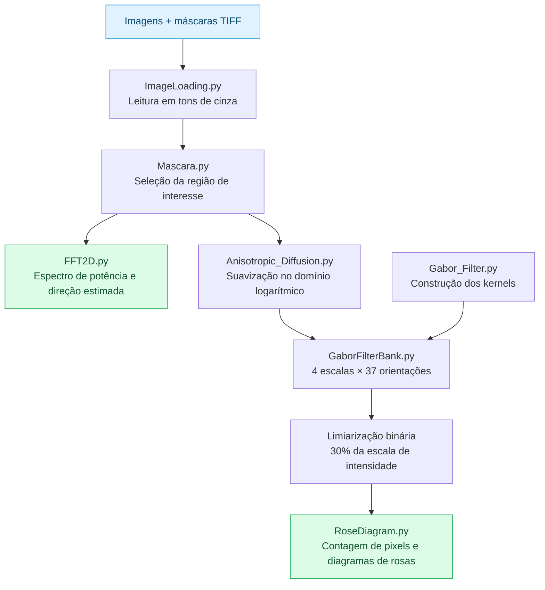
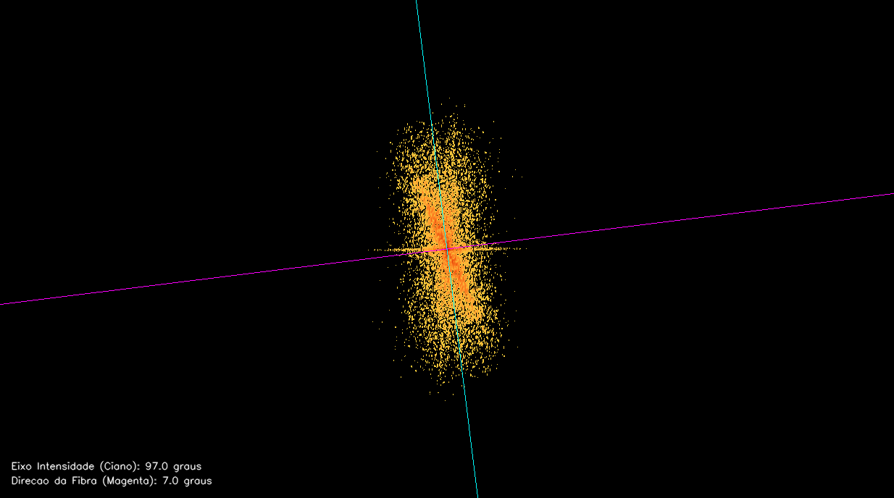
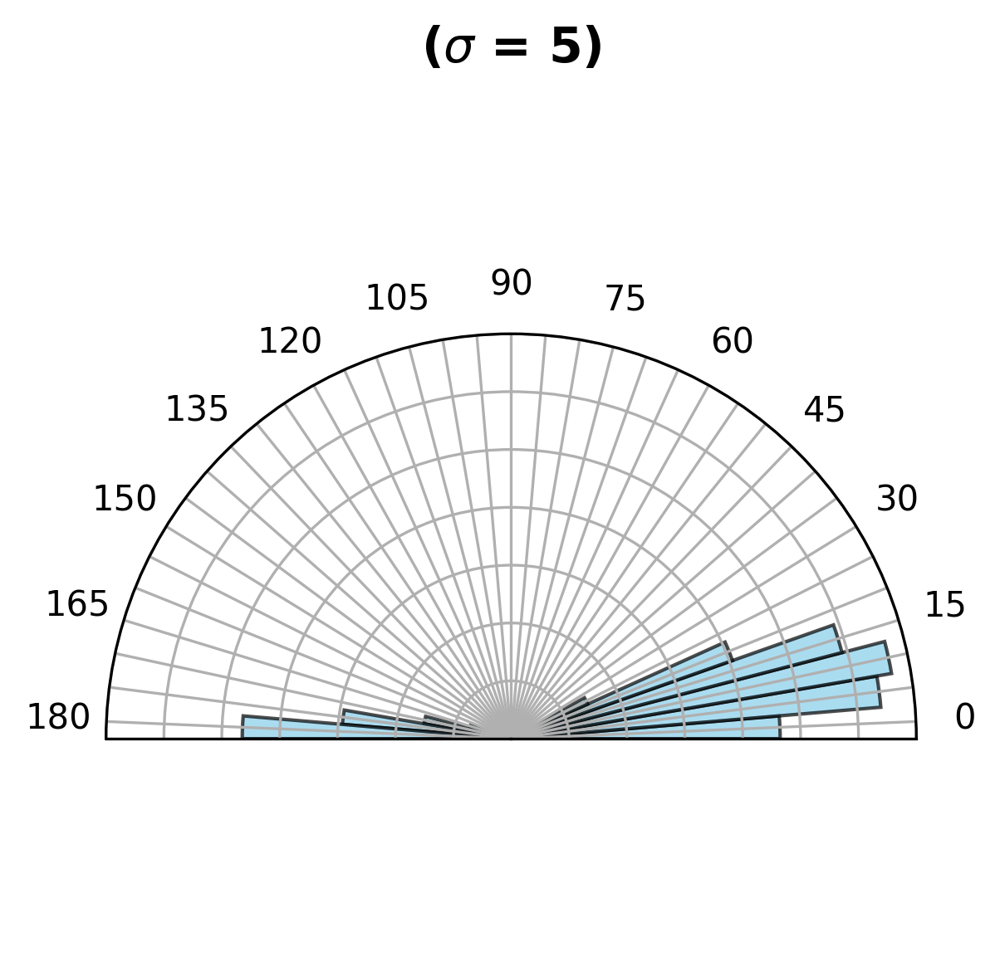

<div align="center">

# 🔬 Projeto PSD

### Análise de orientação de fibras e texturas em imagens

Da região de interesse à distribuição angular: processamento de imagens com difusão anisotrópica, FFT 2D e um banco de filtros de Gabor.


[Sobre](#sobre) · [Funcionamento](#funcionamento) · [Resultados](#resultados) · [Execução](#execucao) · [Estrutura](#estrutura) · [Parâmetros](#parametros)

</div>

---

<a id="sobre"></a>

## 🎯 Sobre o projeto

Este repositório reúne os códigos e arquivos do **Projeto 1 de Processamento de Sinais Digitais (PSD)**. O objetivo é investigar a orientação de estruturas nas imagens, combinando análise no domínio da frequência com filtragem espacial em diferentes escalas e direções.

O processamento parte de imagens e máscaras de seleção. A partir delas, gera regiões de interesse, imagens suavizadas, espectros de frequência, respostas de filtros, imagens binárias e diagramas de rosas para visualizar as orientações com maior resposta.

| Imagens de entrada | Escalas de Gabor | Orientações por escala | Filtros por imagem |
| :---: | :---: | :---: | :---: |
| **5** pares de imagem e máscara | **4** — σ = 2, 5, 10 e 20 | **37** — de 0° a 180°, a cada 5° | **148** combinações |

<a id="funcionamento"></a>

## ⚙️ Como funciona



### 1. Leitura e seleção da região de interesse

O módulo `ImageLoading.py` carrega cada par `ImagemN.tif` e `MascaraN.tif` em tons de cinza. Em `Mascara.py`, a máscara é redimensionada quando suas dimensões diferem das da imagem e binarizada com limiar **127**.

A operação `cv2.bitwise_and` mantém os pixels selecionados pela máscara e zera o restante. O resultado é uma **ROI — região de interesse**, com as mesmas dimensões da imagem original.

### 2. Redução de ruído com difusão anisotrópica

Para preparar a análise por Gabor, `Anisotropic_Diffusion.py` aplica `log(1 + I)` à ROI e suaviza a imagem com uma implementação de difusão anisotrópica baseada nos gradientes nas quatro direções: norte, sul, leste e oeste.

A condução depende da intensidade do gradiente, permitindo suavizar regiões mais homogêneas e reduzir a difusão nas transições mais acentuadas. A configuração atual usa **10 iterações**, `k = 2`, taxa de atualização **0,1** e a função de condução exponencial (`eq = 1`). Ao final, `expm1` retorna ao domínio original, e os valores são limitados a `[0, 255]` e convertidos para `uint8`.

### 3. Filtragem de Gabor em múltiplas escalas e orientações

Em `Gabor_Filter.py`, cada kernel é construído multiplicando um **envelope gaussiano** por uma **onda cossenoidal**, sobre uma grade de coordenadas rotacionada. Isso permite obter respostas seletivas à orientação e à frequência espacial das estruturas.

O banco em `GaborFilterBank.py` combina quatro valores de σ com 37 ângulos. Para cada combinação:

1. Divide a imagem suavizada por 255 para trabalhar no intervalo `[0, 1]`.
2. Cria um kernel de **33 × 33 pixels**, com frequência `0.12`, `gamma = 0.6` e fase `psi = 0`.
3. Aplica convolução bidimensional com `scipy.signal.convolve2d`, mantendo o tamanho da imagem (`mode='same'`).
4. Zera as respostas negativas.
5. Normaliza as respostas para `[0, 255]`, usando um máximo compartilhado entre todos os ângulos de uma mesma imagem e escala.

Os kernels são salvos em PNG, e as imagens filtradas são salvas em TIFF.

### 4. Limiarização e diagramas de rosas

As respostas normalizadas passam por um limiar binário de **`0.3 × 255`**: pixels acima desse valor recebem 255; os demais recebem zero.

`RoseDiagram.py` conta os pixels brancos de cada imagem binária e monta um gráfico polar de **0° a 180°** para cada par de imagem e escala. Barras maiores indicam maior quantidade de pixels que responderam acima do limiar naquela orientação.

> A altura das barras é dividida por `1,5 × a maior contagem` de cada diagrama. Portanto, o gráfico mostra uma distribuição relativa de respostas; as barras não representam diretamente uma porcentagem da área da imagem nem uma contagem individual de fibras.

### 5. Análise complementar com FFT 2D

`FFT2D.py` segue um caminho paralelo: utiliza **diretamente a ROI mascarada**, antes da difusão anisotrópica. O módulo calcula a transformada bidimensional, centraliza as frequências com `fftshift` e obtém o espectro de potência `|FFT|²`.

Depois de aplicar escala logarítmica e normalização para `[0, 255]`, seleciona intensidades acima de **160** e colore o espectro com o mapa `TURBO`. Quando a condição dos momentos da máscara é atendida (`m00 > 10`), estima e desenha dois eixos:

- **Ciano:** eixo principal da distribuição de intensidades no espectro.
- **Magenta:** direção estimada da fibra, perpendicular ao eixo espectral.

Os ângulos são incluídos na legenda da própria imagem de saída.

<a id="resultados"></a>

## 📊 Resultados

Exemplos já incluídos no repositório, referentes à **Imagem 1**:

<table>
  <tr>
    <th align="center" width="50%">FFT 2D · orientação estimada</th>
    <th align="center" width="50%">Diagrama de rosas · σ = 5</th>
  </tr>
  <tr>
    <td align="center"></td>
    <td align="center"></td>
  </tr>
</table>

Com os cinco pares de entrada e a configuração padrão, as duas análises produzem:

| Pasta em `ImagensSaida/` | Conteúdo | Quantidade |
| --- | --- | :---: |
| `ROI/` | Regiões de interesse mascaradas, em TIFF | 5 |
| `DifusaoAnisotropica/` | ROIs após suavização, em TIFF | 5 |
| `FFT2D/` | Espectros coloridos com indicação dos eixos, quando estimados, em PNG | 5 |
| `Kernel/Escala{σ}/` | Kernels de Gabor por escala e ângulo, em PNG | 148 |
| `Gabor/Imagem{N}/Escala{σ}/` | Respostas dos filtros por imagem, escala e ângulo, em TIFF | 740 |
| `Threshold/Imagem{N}/Escala{σ}/` | Respostas binarizadas, em TIFF | 740 |
| `DiagramaDeRosas/Escala{σ}/` | Gráficos polares por imagem e escala, em PNG a 300 dpi | 20 |

<a id="execucao"></a>

## 🚀 Como executar

### 1. Obtenha o projeto

Tenha **Python 3.12**, `pip` e Git disponíveis. As versões das bibliotecas estão fixadas em [`requirements.txt`](requirements.txt).

```bash
git clone https://github.com/JoaoLuisVignoli/Projeto_PSD.git
cd Projeto_PSD
```

Se você já tem o repositório, abra o terminal na pasta que contém este README.

### 2. Crie e ative um ambiente virtual

**Linux / macOS**

```bash
python3 -m venv .venv
source .venv/bin/activate
```

<details>
<summary><strong>Windows · PowerShell</strong></summary>

```powershell
py -3.12 -m venv .venv
.\.venv\Scripts\Activate.ps1
```

</details>

Instale as dependências com o ambiente ativo:

```bash
python -m pip install -r requirements.txt
```

O processamento utiliza principalmente **NumPy** para operações matriciais e FFT, **OpenCV** para leitura, máscaras e gravação, **SciPy** para convolução, **pandas** para organizar os dados dos diagramas e **Matplotlib** para gerar os gráficos.

### 3. Confira as entradas e prepare as pastas de saída

O repositório já contém os cinco pares de entrada. Os arquivos devem seguir esta organização:

```text
ImagensEntrada/
├── Imagens/
│   ├── Imagem1.tif
│   ├── Imagem2.tif
│   └── ... até Imagem5.tif
└── Mascaras/
    ├── Mascara1.tif
    ├── Mascara2.tif
    └── ... até Mascara5.tif
```

Alguns módulos gravam arquivos sem criar previamente a pasta de destino. Para garantir a gravação das saídas, execute os dois comandos abaixo, inclusive se estiver recriando a pasta `ImagensSaida/`:

```bash
python -c "from pathlib import Path; [Path('ImagensSaida', p).mkdir(parents=True, exist_ok=True) for p in ('ROI', 'DifusaoAnisotropica', 'FFT2D')]"
python -c "from pathlib import Path; [Path('ImagensSaida/Kernel', f'Escala{s}').mkdir(parents=True, exist_ok=True) for s in (2, 5, 10, 20)]"
```

> **Atenção no Linux:** o banco de filtros cria uma pasta chamada `kernel`, mas grava os arquivos em `Kernel`. O segundo comando prepara o caminho com a capitalização usada na gravação. As demais pastas de Gabor, threshold e diagramas são criadas pelos próprios módulos.

### 4. Execute as análises

**Banco de Gabor e diagramas de rosas**

```bash
python RoseDiagram.py
```

Esse comando executa, por meio das importações, a leitura, a aplicação das máscaras, a difusão anisotrópica, o banco de Gabor, a limiarização e a geração dos diagramas.

**FFT 2D e estimativa de orientação**

```bash
python FFT2D.py
```

Esse comando executa a leitura, a aplicação das máscaras e a análise espectral. Execute **os dois comandos** para gerar todos os tipos de resultado apresentados acima.

> Execute sempre a partir da raiz do projeto: os caminhos são relativos ao diretório atual. O processamento é feito em lote, e os resultados são gravados em `ImagensSaida/`. Uma nova execução substitui os arquivos de mesmo nome. O banco de Gabor realiza 740 convoluções na configuração padrão; o tempo depende das dimensões das imagens e do computador.

<a id="estrutura"></a>

## 🗂️ Estrutura do repositório

```text
Projeto_PSD/
├── ImagensEntrada/
│   ├── Imagens/                  # Imagens TIFF numeradas
│   ├── Mascaras/                 # Máscaras TIFF correspondentes
│   └── ImagemSintetica.png       # Arquivo adicional; não é carregado pelos scripts
├── ImagensSaida/
│   ├── ROI/
│   ├── DifusaoAnisotropica/
│   ├── FFT2D/
│   ├── Kernel/
│   ├── Gabor/
│   ├── Threshold/
│   └── DiagramaDeRosas/
├── ImageLoading.py               # Carregamento dos pares de entrada
├── Mascara.py                    # Aplicação das máscaras e geração das ROIs
├── Anisotropic_Diffusion.py      # Transformações log/exp e difusão anisotrópica
├── Gabor_Filter.py               # Função de construção do kernel de Gabor
├── GaborFilterBank.py            # Banco de filtros, normalização e limiarização
├── RoseDiagram.py                # Contagem de pixels e gráficos polares
├── FFT2D.py                      # Espectro de potência e estimativa dos eixos
├── requirements.txt             # Dependências com versões fixadas
└── README.md
```

Os módulos de processamento executam código no momento da importação. Por isso, não é necessário rodar cada arquivo separadamente nem seguir uma sequência manual de todos os scripts: `RoseDiagram.py` e `FFT2D.py` acionam suas respectivas dependências.

<a id="parametros"></a>

## 🎛️ Parâmetros e novas imagens

As configurações são definidas diretamente no código:

| Configuração | Valor atual | Onde alterar |
| --- | --- | --- |
| Quantidade de pares de entrada | `numero_imagens = 5` | [`ImageLoading.py`](ImageLoading.py) |
| Limiar para binarizar a máscara | `127` | [`Mascara.py`](Mascara.py) |
| Difusão anisotrópica | `iterations=10`, `k=2`, `refresh_rate=0.1`, `eq=1` | Chamada de `anisotropic_diffusion` em [`Anisotropic_Diffusion.py`](Anisotropic_Diffusion.py) |
| Escalas do banco | `sigma = [2, 5, 10, 20]` | [`GaborFilterBank.py`](GaborFilterBank.py) |
| Orientações do banco | `theta`: de `0` a `180`, em passos de `5` | [`GaborFilterBank.py`](GaborFilterBank.py) |
| Kernel de Gabor | Tamanho `33`, frequência `0.12`, `gamma=0.6`, `psi=0` | Chamada de `gabor_2d` em [`GaborFilterBank.py`](GaborFilterBank.py) |
| Limiar das respostas de Gabor | `0.3 * 255` | [`GaborFilterBank.py`](GaborFilterBank.py) |
| Limiar do espectro FFT | `160` | [`FFT2D.py`](FFT2D.py) |

Para analisar outras imagens, adicione os pares `ImagemN.tif` e `MascaraN.tif` nas pastas de entrada, mantendo a numeração contínua a partir de 1, e ajuste `numero_imagens`. A região branca da máscara indica a área que será preservada. Os arquivos são lidos em tons de cinza, mesmo quando os TIFFs de origem são coloridos.

Se alterar as escalas, prepare também os diretórios `Kernel/Escala{σ}` correspondentes. Se alterar o conjunto de ângulos, ajuste a lista fixa de rótulos `categories` em `RoseDiagram.py`, que atualmente contém 37 posições.

<details>
<summary><strong>🛠️ Dificuldades comuns na execução</strong></summary>

| Sintoma | O que verificar |
| --- | --- |
| `ModuleNotFoundError`, por exemplo para `cv2` | Ative o ambiente virtual e instale o `requirements.txt` com o mesmo interpretador usado para executar os scripts. |
| Falha envolvendo `NoneType` ao acessar uma imagem | Confira o diretório atual, os nomes, a numeração e a existência de todos os pares TIFF esperados por `numero_imagens`. |
| Imagens de saída ou kernels não aparecem | Execute a preparação das pastas e confira a diferença entre `kernel` e `Kernel`. Algumas gravações com `cv2.imwrite` podem falhar sem interromper o programa. |
| Erro de backend gráfico em um servidor Linux sem interface | Use `MPLBACKEND=Agg python RoseDiagram.py` para gerar os gráficos com um backend sem janela. |

</details>
